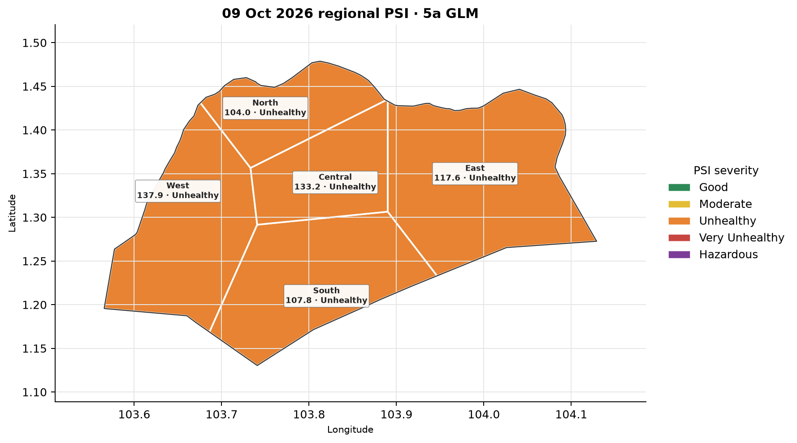

# Singapore Regional PSI and Haze Monitoring

This project combines Singapore air-quality observations, weather reanalysis, and satellite fire-hotspot data to explore haze patterns and forecast 24-hour PSI for the next three days in Singapore's North, South, East, West, and Central regions.

The workflow downloads and prepares daily data, builds lagged predictors, compares a basic and a nonlinear regional forecasting model, and produces a three-day forecast table with prediction intervals and visualizations. The analysis is exploratory: the forecasts are not official NEA advisories.

## Current validation results

This snapshot uses 2,842 daily rows from 1 Jan 2019 through 12 Oct 2026. RMSE values below are unweighted means of the five region-specific RMSEs, evaluated on the same five chronological test folds with a horizon-sized purge gap.

- **Next day (t+1):** repeating today's PSI scores **7.50 PSI RMSE**, slightly better than the selected 5a GLM (**7.62**) and the nonlinear 5b GLM (**8.16**). The model does not beat the persistence baseline for tomorrow.
- **Days t+2 / t+3:** persistence scores **10.24 / 11.20 PSI RMSE**; 5a scores **9.52 / 10.48**; 5b scores **10.12 / 10.75**. The GLM models help more at the longer horizons.
- **All three horizons:** the 5a GLM has the lowest mean region-horizon RMSE at **9.21 PSI**, compared with **9.65** for persistence and **9.68** for 5b. Part 6 therefore uses 5a overall; this average does not mean it wins at every horizon.

**Forecast map** (12 Oct 2026):



**Live dashboard:** This repository does not have a deployed app URL yet. [Open Streamlit Community Cloud to deploy it](https://share.streamlit.io/); setup steps are in [Publish on Streamlit Community Cloud](#publish-on-streamlit-community-cloud) below.

## What the analysis does

The notebook explores:

- Daily PSI history and the timing of unhealthy episodes.
- The relationship between recent Sumatra/Borneo hotspot counts and next-day PSI.
- Dry-season PSI and unhealthy-day rates by wind direction and wind-speed quartile.
- Fire detections near the worst observed haze day, including a map with Natural Earth country boundaries.
- Regional PSI forecasts for t+1 through t+3 using the seven daily observations from t-6 through t.
- Horizon-specific walk-forward RMSE against a tomorrow = today persistence baseline, confidence scores (historical share of predictions within 10 PSI), and 80%/95% prediction intervals.

Parts 5 and 6 refresh the API-backed daily tables before modeling, then use the seven daily observations from t-6 through t to predict PSI at t+1, t+2, and t+3. Part 5 compares a regularized linear Gaussian GLM (5a) and nonlinear extension (5b) with a persistence baseline that repeats PSI observed at t. All three are evaluated on identical five-fold chronological test dates for all five regions and three horizons, with a purge gap equal to the horizon; only 5a and 5b are candidates for the Part 6 model selection. Both models tune ridge regularization inside each training fold. Part 5b adds log and squared terms and same-day interactions among PSI, wind, hotspots, and rain. Predictors include regional PSI, wind direction components and speed, hotspot counts by source region, rainfall, and humidity. Part 3 also compares dry-season PSI and unhealthy-day rates across wind direction and daily maximum wind-speed quartiles.

## Data sources

| Source | Data used | Access |
|---|---|---|
| [data.gov.sg](https://data.gov.sg) / NEA | Hourly regional 24-hour PSI and PM2.5 | Free API; API key is optional but speeds up downloads |
| [Open-Meteo Historical Weather API](https://open-meteo.com/en/docs/historical-weather-api) | Daily Singapore weather, including wind, rain, temperature, and humidity | Free; no key required |
| [NASA FIRMS](https://firms.modaps.eosdis.nasa.gov) | VIIRS S-NPP satellite fire detections around Sumatra, Peninsular Malaysia, and Borneo | Free MAP_KEY required for API downloads |
| [Natural Earth](https://www.naturalearthdata.com/) and [OpenStreetMap Nominatim](https://nominatim.org/) | Country boundaries and Singapore outline used in notebook maps | Public datasets/services; internet required for map cells |

The study period begins on 1 January 2019 and, by default, continues through the latest date available to each source. PSI and weather availability may differ at the most recent dates.

## Installation and API keys

Use Python 3.10 or newer. The Streamlit app installs only its runtime dependencies:

```powershell
.\.venv\Scripts\python.exe -m pip install -r requirements.txt
```

For notebook analysis and map cells, install the additional notebook packages with `python -m pip install -r requirements-notebook.txt`. The smaller `requirements.txt` is also the dependency file used by Streamlit Community Cloud.

Create a `.env` file in the project root for API credentials:

```dotenv
FIRMS_MAP_KEY=your_nasa_firms_map_key
DATA_GOV_SG_API_KEY=your_data_gov_sg_api_key
```

Get a NASA FIRMS key from the [FIRMS MAP_KEY page](https://firms.modaps.eosdis.nasa.gov/api/map_key/). Get an optional data.gov.sg key by signing in to [data.gov.sg](https://data.gov.sg/). The `.env` file is ignored by Git; do not commit credentials.

## Run the pipeline

Run commands from the project root in this order:

```powershell
python src/1_get_psi.py
python src/2_get_weather.py
python src/3_get_hotspots.py
python src/4_build_dataset.py
```

The PSI downloader caches daily API responses, so it can resume and rebuild regional daily summaries without fetching already-cached dates again. If the FIRMS API is unavailable, manually downloaded country CSVs can be placed in `data/raw/firms_manual/`, then run:

```powershell
python src/3_get_hotspots.py --from-folder
```

Open `notebooks/haze_analysis.ipynb` and run it from top to bottom after the pipeline completes. Its map cells need internet access to retrieve boundary geometry.

## Run the live dashboard

From the project root, install requirements and start the local app:

```powershell
.\.venv\Scripts\python.exe -m pip install -r requirements.txt
.\.venv\Scripts\python.exe -m streamlit run app.py
```

The dashboard refreshes recent PSI and weather data on launch and every six hours while open. NASA FIRMS hotspot updates require `FIRMS_MAP_KEY` in `.env`; PSI and weather refresh without that key. Each refresh merges newer observations into the historical daily tables and keeps data from 1 January 2019 onward for the model comparison. Raw PSI downloads are limited to the recent refresh window, and the point-level FIRMS map cache is limited to 180 days; daily history remains available for training. Because you chose to preserve the full 2019 onward model history, its daily row count grows by about one row per day rather than staying fixed. The app refits the saved Part 5 winner on current data and reuses its saved walk-forward calibration ranges, avoiding the full multi-fold model search on each refresh. To update the selected model or its calibration after changing data or model settings, rerun notebook Parts 5 and 6. Press **Refresh data now** to bypass the six-hour cache.

### Publish on Streamlit Community Cloud

Community Cloud deploys from a GitHub repository. Push the app files to the branch you want to deploy, then create an app at [share.streamlit.io](https://share.streamlit.io) with `app.py` as the entrypoint. In **Advanced settings → Secrets**, add any API keys the app should use, for example:

```toml
FIRMS_MAP_KEY = "your_nasa_firms_map_key"
DATA_GOV_SG_API_KEY = "your_data_gov_sg_api_key"
```

Do not commit `.env` or `secrets.toml`; Community Cloud reads secrets from the app settings. Choose the app's sharing visibility in Community Cloud settings. After deployment, its `streamlit.app` URL can be shared. The app refreshes its data in the cloud when it runs; Community Cloud's local filesystem is ephemeral, so refreshed files are not a permanent archive.

Weather for the latest days comes from Open-Meteo's forecast API because its historical archive is published with a delay. Check the displayed input date to see the last complete seven-day feature window used for a particular forecast. The displayed confidence score and 95% range are based on historical walk-forward errors and do not guarantee an individual forecast.

## Forecast models

Part 5 compares two model candidates and a simple persistence benchmark independently for each Singapore region and horizon:

| Part | Model | Approach |
|---|---|---|
| 5a | Gaussian GLM | Regularized linear baseline with an identity link and out-of-fold residual diagnostics |
| 5b | Nonlinear Gaussian GLM | Adds `log1p` transforms, squared terms, and same-day PSI-weather-fire interactions; includes out-of-fold residual diagnostics |
| Benchmark | Tomorrow = today | Repeats the region's latest observed PSI for the target day; evaluated on the same outer test folds |

Part 5 evaluates all three approaches on the same five chronological `TimeSeriesSplit` folds for each region and horizon, with a purge gap matching the forecast horizon. It selects between 5a and 5b using mean RMSE across the 15 region/horizon combinations; the persistence baseline is a benchmark, not a candidate for selection. Both models tune ridge alpha inside the training data without using the outer test fold; Part 6 repeats tuning within each calibration fold and for the final fit. Part 6 uses the Part 5 winner by region and horizon with the same seven-day input window; it reports horizon-specific walk-forward RMSE, 80%/95% prediction intervals, and a within-10-PSI confidence score from held-out residuals. These are historical validation estimates, not guarantees of future performance. PSI severity episodes are rare, and high readings may still be underpredicted.

Model scores and the selected model are recalculated from refreshed data whenever the notebook Parts 5 and 6 are rerun. The nonlinear extension may improve accuracy but is selected only when its chronological validation RMSE is lower.

The Singapore map colors regions and labels them with the selected model's t+1 PSI prediction and a severity category. Its five-zone polygons are approximate Voronoi partitions around representative locations, not official PSI monitoring boundaries. The trend chart shows the previous seven days of observed PSI and the next three forecast days; the thicker line is the average across the five regions. The confidence score is the historical share of walk-forward predictions within 10 PSI, while the prediction intervals are empirical ranges; neither guarantees the accuracy of an individual forecast.

## Generated files

| File | Description |
|---|---|
| `data/processed/psi_daily.csv` | Daily island-wide summaries and PSI maxima for each of the five regions |
| `data/processed/weather_daily.csv` | Daily Singapore weather observations |
| `data/processed/hotspots_daily.csv` | Daily fire counts by source region |
| `data/processed/hotspots_points.csv` | Individual hotspot detections used in maps; ignored by Git because it can be large |
| `data/processed/model_table.csv` | Merged daily feature and target table |
| `data/processed/regional_psi_forecast.csv` | Part 5 selected-model predictions for three forecast horizons by region, with 80% and 95% prediction intervals |
| `figures/regional_psi_forecast_map.png` | Selected-model regional PSI forecast map |
| `figures/regional_psi_forecast_trend.png` | Seven-day regional PSI history and forecast chart |
| `figures/glm_residual_diagnostics.png` | Five-fold out-of-fold residual diagnostics for the Gaussian GLM, with horizons distinguished |
| `figures/nonlinear_glm_residual_diagnostics.png` | Five-fold out-of-fold residual diagnostics for the nonlinear Gaussian GLM |
| `figures/psi_by_wind_and_speed.png` | Dry-season PSI by wind direction and daily maximum wind-speed quartile |

Raw downloads under `data/raw/` are cached locally and excluded from Git.

## Repository layout

```text
src/           Numbered download, dataset-building scripts, and config.py
notebooks/     Exploratory analysis, model evaluation, and forecasts
requirements.txt
requirements-notebook.txt
data/          Raw caches and generated processed data
figures/       Generated plots
```
